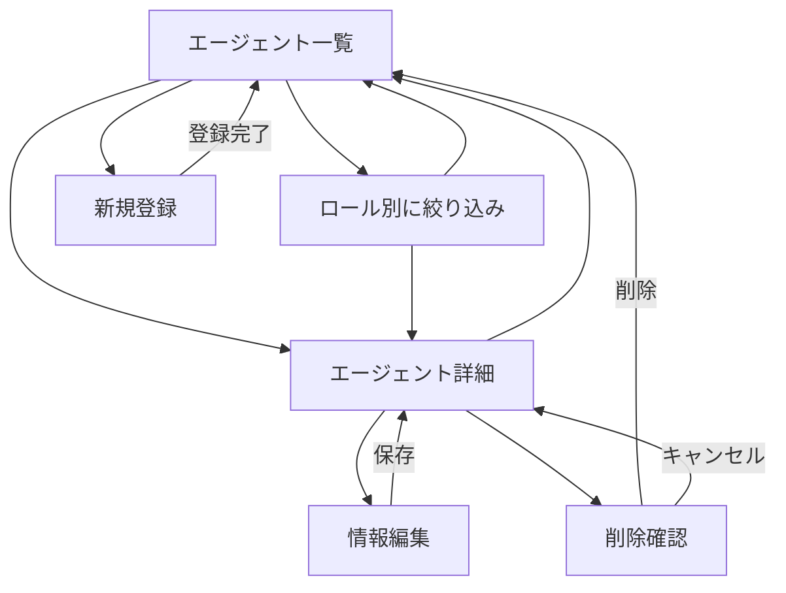
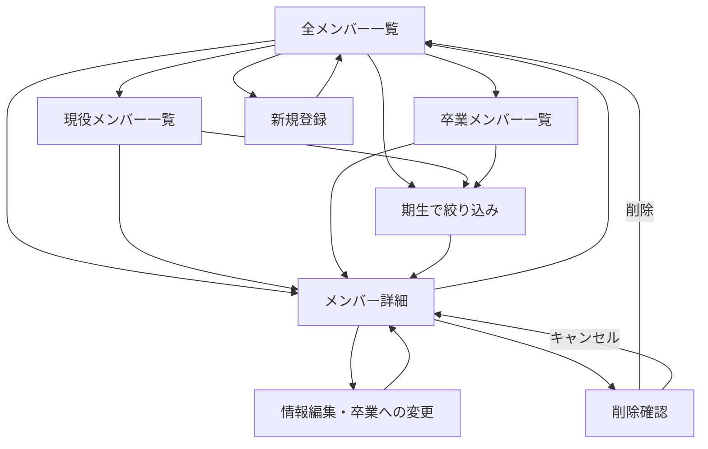
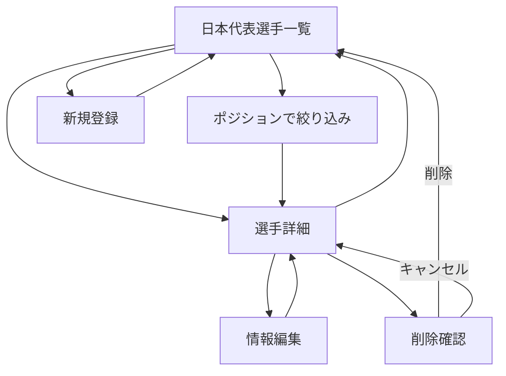

# Webアプリケーション設計案

## 1. VALORANTエージェント管理システム

### 1.1 システムの概要
VALORANTに登場するエージェントの情報を管理するWebアプリケーションである。
エージェントの名前、ロール、出身地、アビリティなどを一覧・詳細画面で確認できる。
ロール（デュエリスト、イニシエーター、コントローラー、センチネル）によって一覧を絞り込み、目的に合ったエージェントを探せるようにする。

エージェントごとに一意なIDを付けて管理し、ゲーム内で情報が更新された場合は登録済みデータを変更する。

### 1.2 利用者向け
- すべてのエージェントの一覧を表示する。
- ロール別にエージェントを絞り込んで表示する。
- エージェント名を選択すると、出身地やアビリティなどの詳細を表示する。
- 詳細画面から一覧画面に戻れるようにする。

### 1.3 管理者向け
- 新しいエージェントを登録する。
- エージェントのロールやアビリティなどの情報を変更する。
- 誤登録や重複登録のデータを削除する。
- 同じエージェントを二重に登録しないよう、IDと名前を確認する。

### 1.4 開発者向け

#### ページ遷移
- 全エージェント一覧画面：`/agents`
- ロール別一覧画面（例）：`/agents?role=duelist`
- エージェント詳細画面：`/agents/:id`
- 追加画面：`/agents/new`
- 編集画面：`/agents/:id/edit`
- 削除確認画面：`/agents/:id/delete`

※ `role` は一覧画面の絞り込み条件であり、別のデータを作成するものではない。画面上では「デュエリスト」などの日本語表記を使用する。

#### スキーマ

| 項目名 | 型 | 内容 | 制約・形式 |
|---|---|---|---|
| id | 整数 | エージェントを一意に識別するID | 正の整数・重複不可・必須 |
| name | 文字列 | エージェント名 | 必須・重複不可 |
| role | 文字列 | ロール | `duelist`、`initiator`、`controller`、`sentinel` のいずれか |
| origin | 文字列 | 出身地・出身地域 | 不明な場合は空欄可 |
| abilities | 文字列の配列 | アビリティ名の一覧 | 例：`["アビリティA", "アビリティB"]` |

## 2. 日向坂46メンバー管理システム

### 2.1 システムの概要
日向坂46の現役メンバーと卒業メンバーの情報を管理するWebアプリケーションである。
メンバーの在籍状態によって現役と卒業を分類し、それぞれの一覧を表示できるようにする。
さらに期生による絞り込みを可能にし、名前、期生、生年月日、出身地、サイリウムカラー、卒業日などを確認できるようにする。

### 2.2 利用者向け
- 現役・卒業を含む全メンバーの一覧を表示する
- 現役メンバーだけ、または卒業メンバーだけを表示する
- 期生でメンバーを絞り込む（在籍状態との組み合わせも可能）
- メンバーの名前を選択するとプロフィールの詳細情報を表示する

### 2.3 管理者向け
- 新しいメンバーの情報を追加する
- 登録済みのメンバー情報を変更する
- 卒業時には情報を削除せず、在籍状態を「現役」から「卒業」に変更する
- 卒業日を登録・変更する
- 誤登録など、不要な情報を削除する

### 2.4 開発者向け

#### ページ遷移
- 全メンバー一覧画面：`/hinatazaka`
- 現役メンバー一覧画面：`/hinatazaka?status=active`
- 卒業メンバー一覧画面：`/hinatazaka?status=graduated`
- 期生で絞り込んだ一覧画面（例）：`/hinatazaka?generation=4`
- 在籍状態と期生を組み合わせた一覧画面（例）：`/hinatazaka?status=active&generation=4`
- メンバー詳細画面：`/hinatazaka/:id`
- 追加画面：`/hinatazaka/new`
- 編集画面：`/hinatazaka/:id/edit`
- 削除確認画面：`/hinatazaka/:id/delete`

※ `status` と `generation` は一覧画面の表示条件であり、別のデータとして管理するわけではない。

#### スキーマ

| 項目名 | 型 | 内容 |
|---|---|---|
| id | 整数 | メンバーを一意に識別するID |
| name | 文字列 | メンバー名 |
| generation | 整数 | 期生（例：4） |
| birthday | 文字列 | 生年月日（YYYY-MM-DD形式） |
| birthplace | 文字列 | 出身地 |
| penlightColor | 文字列 | サイリウムカラー |
| status | 文字列 | `active`（現役）または `graduated`（卒業） |
| graduationDate | 文字列またはnull | 卒業日（YYYY-MM-DD形式）。現役の場合は `null` |

## 3. サッカー日本代表選手管理システム

### 3.1 システムの概要
サッカー日本代表に招集された選手の情報を管理するWebアプリケーションである。
選手名、ポジション、背番号、所属クラブ、出身地などを一覧・詳細画面で確認できる。

日本代表の招集選手や背番号は時期によって異なるため、**管理対象は特定の招集発表日、または特定の大会の代表メンバーに統一する**。採用した時点を `selectionDate` に記録し、その時点での情報として扱う。
実データを登録する際に、対象の招集発表日（`YYYY-MM-DD`）と大会・活動名を決める。

### 3.2 利用者向け
- 日本代表選手の一覧を表示する。
- 選手名を選択すると詳細情報を表示する。
- ポジション別に選手を絞り込めるようにする。
- 選手の詳細画面から一覧へ戻れるようにする。

### 3.3 管理者向け
- 新しい選手情報を追加する。
- 登録済みの選手情報を変更する。
- 重複登録や誤登録のデータを削除する。
- 対象となる招集時期を統一して情報を管理する。

### 3.4 開発者向け

#### ページ遷移
- 選手一覧画面：`/japan-players`
- ポジションで絞り込んだ一覧画面（例）：`/japan-players?position=MF`
- 選手詳細画面：`/japan-players/:id`
- 追加画面：`/japan-players/new`
- 編集画面：`/japan-players/:id/edit`
- 削除確認画面：`/japan-players/:id/delete`

※ `position` は一覧画面の表示条件であり、別の選手データを作成するものではない。

#### スキーマ

| 項目名 | 型 | 内容 | 制約・形式 |
|---|---|---|---|
| id | 整数 | 選手を識別するID | 重複不可・必須 |
| name | 文字列 | 選手名 | 必須 |
| position | 文字列 | ポジション | `GK`、`DF`、`MF`、`FW` のいずれか |
| number | 整数または null | 代表での背番号 | 未発表の場合は `null` |
| club | 文字列 | 招集時点での所属クラブ | 必須 |
| birthplace | 文字列 | 出身地 | 未確認の場合は空欄可 |
| selectionDate | 文字列 | 対象とする招集発表日 | `YYYY-MM-DD` 形式・必須 |
| selectionName | 文字列 | 対象となる大会名・活動名 | 必須 |